# Rocks'n'Diamonds for AmigaOS 3.x / AmiCradle

Rocks'n'Diamonds is Holger Schemel's arcade puzzle game in the line of
Boulder Dash, Emerald Mine, Supaplex and Sokoban: dig, collect the
diamonds, mind the rocks, with a level editor and native engines for those
games' level sets. The engine is GPL-2.0 (`COPYING`). This repository holds
the upstream tree as imported (upstream
[ArtsoftEntertainment/rocksndiamonds](https://github.com/ArtsoftEntertainment/rocksndiamonds)
at `b42509b0cc55e6eb6b48953be946c09ac24cf6a3`, version 4.4.2.4, identical
file for file apart from `AMIGA_PORT.md`, the repo guard workflow and this
`README.md`) and the AmiCradle port around it: 68040 + FPU, libnix, SDL 2,
SDL2_image and SDL2_mixer through GFOpenGPU, GFOpenAmigaGCC 16.2.0-open5.
Upstream's own documents are `INSTALL`, `CREDITS`, `ChangeLog` and `docs/`.

The game data in the tree has no licence of its own. Until Dale decides on
it, nothing from it is for publication (see Data and licences).

## Feasibility

Rocks'n'Diamonds 4.x is an SDL 2 program already: it draws into one 32-bit
surface of its own and shows it through an SDL renderer, loads PNGs with
SDL2_image, plays WAVs (and music modules) with SDL2_mixer, and reaches the
network with SDL_net. The SDK has SDL 2 (2.32.10, GFOpenGPU's
`SDL2.module`), SDL2_image and SDL2_mixer, and zlib in the stove's locked
`port-deps`, so most of the source builds as it is. The changes are
patches, applied to a copy:

| Patch | What it does |
|---|---|
| `0001-amiga-platform.patch` | AmigaOS is a platform of its own (upstream would take it for Unix: `pwd.h`, `/dev/urandom`, signals): the data in the program's drawer (`PROGDIR:`), the user data in `PROGDIR:userdata` (upstream's own name for it on systems without a home directory); AmigaDOS path joining (`PROGDIR:` and `levels` make `PROGDIR:levels`, as a `/` after the colon would mean the parent drawer); the random seed from the clock; 32-bit offsets for the zip code (libnix has no 64-bit file calls) |
| `0002-amiga-no-network.patch` | No network code: `src/libgame/net_none.c` takes the place of SDL_net, every call failing as SDL_net does with no network. Network games and the score server are then unavailable, as upstream handles a network it cannot reach; the program needs no TCP/IP stack and opens no `bsdsocket.library` |
| `0003-amiga-presentation.patch` | Images with alpha on a big-endian machine (upstream keeps an RGBA image's alpha mask, which falls on the back buffer's blue byte on a 68k, and SDL knows no such format: the game stopped at its first image); on AmigaOS full screen is a screen of the game's own in the display mode closest to its 672x560 frame, the frame drawn 1:1 in the middle, and it is the default; with `SetEnv RND_FPS 1` each second's frame rate goes to the program's output |
| `0004-amiga-input.patch` | On AmigaOS each start logs the joysticks and game controllers SDL finds; with `SetEnv RND_INPUT 1` every key, joystick and controller event the game takes goes to the program's output with its time. Upstream's input itself is unchanged |
| `0005-amiga-sound.patch` | Upstream's sound code and SDL_mixer unchanged. On AmigaOS 1024 samples a buffer by default (upstream 512; Windows already takes 1024), the audio driver and format logged at start, and with `SetEnv RND_FPS 1` the buffers mixed and those more than half a buffer late every five seconds |

What could stop it: the game draws every frame by the CPU into a 672x560
32-bit surface and has SDL copy that to the screen, about 1.5 MB a frame.
If the 68040 cannot hold the game's own 50 frames a second at that size,
that is reported, not hidden.

## Building

The port never edits the imported tree: `build-amiga.sh` copies `src/`,
applies `patches/` with no fuzz, writes the `conf_*.h` headers with
upstream's own generator (`build-scripts/create_element_defs.pl`, Perl) as
`make auto-conf` would, and compiles upstream's own source lists (the
Makefiles' `SRCS`) with the stove's compiler, linking the stove's
`libSDL2.a`, `libSDL2_image.a`, `libSDL2_mixer.a`, `libGL.a` and `libz.a`.

Through Cradle (the build the lab tests use): `stove_build` with the stove
`os32-gcc16`, target `.` for the program and target `runtime-data` for the
game data. From a checkout, with a staged stove:

```sh
STOVE=/path/to/os32-gcc16 OUT=build-amiga sh build-amiga.sh
STOVE=/path/to/os32-gcc16 OUT=build-amiga/data sh runtime-data/build-amiga.sh
```

`build-amiga.sh` takes GFOpenAmigaGCC 16.2.0-open5 (Cradle's `os32-gcc16`;
no archive is published, so its receipt records the SHA-256 of the
compiler's own programs), or OpenAmigaGCC 16.2.0-open3 (archive SHA-256
`9fcc136ab59e3bb5b91d2764d0bf290b709d72d7380be4ce0cdf005edf8eff21`) or
open4 (`495319a2ffd803278f8827cad70074029c7aa9ecbe05d037e8646ba43ab94ab2`),
and refuses any other. Its `receipt.json` names the compiler, the patches'
and the recipe's digests, the SDK inputs and the executable's SHA-256; the
receipts of the builds recorded here are in `receipts/`.

The game data ships as `rnd-data.tar`, a plain ustar archive, with
`untar`, a small Amiga unpacker (`runtime-data/untar.c`, from
amigakobodeluxe; OS 3.2 has no archiver). What goes in it is
`gameports/catalog.json`'s `runtimeData`: its directories less the
excluded files, which the script checks again. `SHA256SUMS` lists every
data file.

## Installing (lab)

Make a drawer, for example `Work:Games/RocksnDiamonds`, put in it
`rocksndiamonds` and `COPYING` (from the program's build) and `untar` (from
`runtime-data`), then in a Shell:

```
CD Work:Games/RocksnDiamonds
untar rnd-data.tar Work:Games/RocksnDiamonds
```

The program reads `graphics/`, `sounds/`, `music/`, `levels/`, `docs/` and
`conf/` beside itself (`PROGDIR:`) and writes only in `PROGDIR:userdata`
(made on first start). It needs GFOpenGPU with its `SDL2.module`,
`SDL2_image.module` and `SDL2_mixer.module` (in `LIBS:GFOpenGPU/`, and in
`LIBS:OpenGPU/` for older systems), and a 68040 or 68060 with its FPU.

## Running

`rocksndiamonds` with no options opens a screen of its own in the display
mode closest to the game's 672x560 frame (800x600 on AmiCradle's RTG) and
draws the frame on it unscaled, in the middle (upstream's full screen is the
desktop's mode with the frame scaled to fill it). F11 or Alt+Return
(upstream's keys), or Setup, Graphics, Fullscreen, switch to a window on the
Workbench and back; the choice is saved. Upstream's own controls: the
cursor keys move, Left Ctrl snaps (digs or collects without moving), Right
Ctrl places dynamite, Space pauses, Escape leaves a game. Settings, scores,
tapes and the user's own levels are in `PROGDIR:userdata`.

A joystick or pad: upstream gives any connected one to player 1 while no
player has a joystick configured, beside the keyboard, so a stick in port 2
(or a GFOpenInput pad) works with no setup; Setup, Input Devices chooses
one for each player; upstream's settings give the first button snap and
the second dynamite.

`SetEnv RND_FPS 1` before starting it logs each second's frame rate and
the time each frame took to reach the screen to the program's output (`Run
>RAM:rnd.log rocksndiamonds`), with the time of the first frame shown on
every start.

## Status

**TESTING**, not RELEASE (see Observed below and the release gates in
amicradle `docs/porting/MEASUREMENT.md`).

| Gate | State |
|---|---|
| Pinned source, reproducible build, receipts | done (open5, Cradle) |
| Launch to the title and menu, a screen of its own, the frame 1:1 | done (menus and play at the game's 50 frames a second) |
| Keyboard play | done (menus, moving, digging, collecting, snapping; every key in the input log) |
| Joystick / pad | not tested: SDL finds and opens port 2 as a game controller; no stick in the lab |
| Sound | AHI opened and fed at 22,050 Hz, 1024-sample buffers, 4 late buffers in 6,054; not heard (muted lab); no whole-lab stop in any run |
| Players, settings and saved games (tapes) across a cold restart | done (`PROGDIR:userdata`) |
| Drawer with GlowIcons, LhA package, installed on a fresh lab from the LhA alone | not yet |
| Network play, the score server | not built (no network code) |

## Data and licences

The engine is GPL-2.0 (`COPYING`, Artsoft Entertainment and Holger
Schemel; `src/libgame/hash.*` and `src/libgame/random.c` carry their own
permissive notices). The data beside it, as imported, carries **no licence
of its own**: no file in `graphics/`, `sounds/`, `music/` or `levels/` names
one, upstream's repository has no licence file for them, and the game's own
info screen calls the game "Freeware". Distributions read that differently:
Debian removes `graphics`, `levels`, `music` and `sounds` from its source
package because their licence is unclear (and so ships the game in
`contrib`, fetching the data at install time); Arch packages the same data
as GPL-2.0-only. This port takes the careful reading, part by part:

| Data | Whose | Packed |
|---|---|---|
| `levels/Classic_Games/` (Boulder Dash, Emerald Mine, Supaplex, Sokoban) | Recreations of the levels of the commercial originals (First Star Software, Kingsoft, Digital Integration, Thinking Rabbit) | **Never** |
| `music/mus_classic/mod.apoplexy`, `mod.chiptune`, `mod.cream_of_the_earth` | Demoscene modules by Bee Hunter/Jazz (1994), 4-Mat/Anarchy (1991) and Romeo Knight/Red Sector (1993), credited in `CREDITS`, with no licence | **Never** |
| `graphics/gfx_classic/` | Holger Schemel, with toons by Thomas Andrae (Mirror Magic) and Karl Hörnell (Iceblox) and improvements by The Onyx Guy (`CREDITS`) | Lab runs only |
| `sounds/snd_classic/`, `music/mus_classic/rhythmloop.wav` | Holger Schemel, with sounds and the rhythm loop by Majid Katzer (Mirror Magic) | Lab runs only |
| `levels/Tutorials/` | Niko Böhm, Aaron Davidson and ncrecc (whose README says the set's own music was taken out to keep it "copyright friendly") | Lab runs only |
| `docs/`, `conf/gamecontrollerdb.txt` | Upstream's help texts; SDL's community controller list (zlib) | Lab runs only |

Without its graphics the game cannot start, so the port is built and tested
with the "lab runs only" data, and nothing is published until Dale decides
whether upstream's own data may ship (and under which licence it is named),
or whether it must wait for upstream to state one. The classic games' levels
and the three modules stay out whatever is decided.

## Observed

### Build, 3 November 2026

The first build (commit `796aae9`, Cradle job `j20261103T083815-f0f0ae`,
48 seconds): a clean compile and link of upstream's 84 source files and the
port's `net_none.c`, with patches 0001 and 0002. The compiler's warnings are
upstream's own (three: two `isspace` on a `char`, one variable the compiler
cannot see set), none in the patches. zlib came from the stove's locked
`port-deps`. The data (commit `eadcf6e`, job `j20261103T084048-ea0612`): 637
files, 1,768,711 bytes, in a 2,304,000-byte archive (`402ca165...8358`).
The build of this README's commit (`a882322`, job
`j20261103T084602-4a24e8`): SHA-256
`c95700ccfd6ce17ae9f171b90a95a22df4778b845792145de9841dfccebc257d`
(3,034,200 bytes; `receipts/1-build-open5-stove_build.json`). Each commit
builds its own bytes: the build date and commit are compiled in, as
upstream's Makefile does.

In `lab:rnd`, a copy of Instance-32 (AC090 JIT, 68040 + FPU, RTG
1920x1080, AHI, muted), with gfopenrtg's SDL2.module and SDL2_mixer.module
(from the amigachocolatedoom package job `j20261103T022105-893438`,
gfopenrtg `210df77`) and the instance's own SDL2_image.module in both
`LIBS:GFOpenGPU/` and `LIBS:OpenGPU/`: `untar` unpacked all 637 files; the
program opened its 672x560 window on the Workbench, made
`PROGDIR:userdata` with its configuration, cache and the user's level
drawer, and showed upstream's own error screen: `SDL_ConvertSurface()
failed: Unknown pixel format`. That is an upstream big-endian fault, fixed
in the presentation step.

### Presentation, 3 November 2026

Commit `fe2fbd6` fixed the stop at the first image (`0003`, the alpha mask
on a big-endian machine); the later commits of the step add the frame log
and the screen of its own. Final build: commit `3783f4d`, Cradle job
`j20261103T092616-2d5f5e`, SHA-256
`7bdc3127436411275cb482928e226f8afea089224737c4a1d997c95ce4f629b5`
(3,035,024 bytes; `receipts/2-presentation-open5-stove_build.json`). In
`lab:rnd` as above, from a Shell, `SetEnv RND_FPS 1`:

- Loading: upstream's own loading screen, then each graphics sheet
  converted in turn; the menu after 1 to 2 minutes of wall time in this
  lab (16 to 60 seconds by SDL's own clock: the lab's clock ran slow under
  the host's load).
- **The window** (upstream's default; the build of `f4e4243`, job
  `j20261103T091530-3afb54`, before full screen became the default): the menu and a
  level of Niko Böhm's tutorial at **49 to 50 frames a second** in nearly
  every one-second reading over almost three minutes (42.7 at the lowest),
  the game's own rate (it draws a frame each 20 ms); putting a frame on
  the screen (the texture update, upstream's two copies, the present) took
  9 to 13 ms on average.
- **Upstream's full screen** (`fullscreen: true`, SDL's desktop full
  screen): a 640x480 screen, the 672x560 frame squeezed to fit it, out of
  proportion, and mostly 41 to 50 frames a second, with dips to 27 (and one
  reading of 8.9).
- **This build's full screen** (the default now): an 800x600 screen of its
  own (`window surface in video RAM (800x600)`), the frame 1:1 in the middle
  with a black border. Menus and play at 44 to 50 frames a second, with
  short dips to 20 to 35 when the host was busiest, and 50.0 with 2 to 3 ms
  a frame in the quieter stretch at the end. Alt+Return gave the window on
  the Workbench and Alt+Return again the screen; Quit wrote
  `PROGDIR:userdata/setup.conf` with `fullscreen: on`.

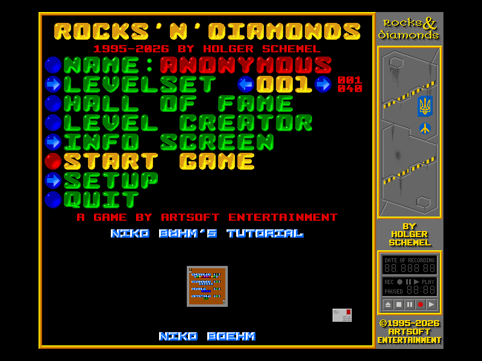
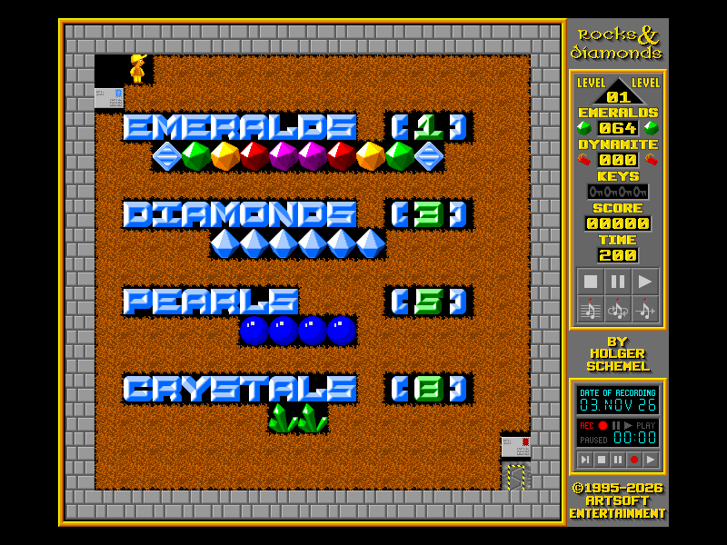
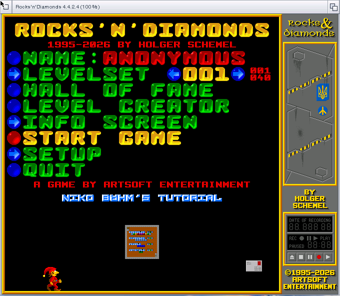

Not tried: an RTG board without an 800x600 mode, AGA without RTG.

### Controls, 3 November 2026

Commit `03cfbba` adds `patches/0004-amiga-input.patch` and the lab tools in
`tests/lab` (HoldKeys from amigakobodeluxe; PortWatch, ScreenGrab and
SplitFile from amigachocolatedoom; Cradle job `j20261103T093709-2b0a7f`).
Executable (open5, Cradle job `j20261103T093747-df4d02`): SHA-256
`13ee64696dea8e8fef0fa0a2c4a6055dc2dfd082743daac76428206b1a4bd448`
(3,036,844 bytes; `receipts/3-input-open5-stove_build.json`).

In `lab:rnd`, on the game's own screen, `SetEnv RND_INPUT 1`:

- Return started the first level of Niko Böhm's tutorial;
  `HoldKeys 30 CYCLE 4E,4D,4E,4D,4F,4C PERIOD 30` then held the cursor
  keys in turn (right, down, right, down, left, up), about 1.1 s each, for
  55 seconds of the game's clock. The player dug through the sand in all
  four directions and collected (score 20, the emeralds still needed down
  from 64 to 48). The input log has every one of those presses and
  releases with its time (`input 131.944 key Right down` ...).
- `HoldKeys 6 HOLD 63 CYCLE 4C,4F PERIOD 30`: Left Ctrl held with Up and
  Left in turn. The player stayed where he was and the sand beside him went:
  upstream's snap.
- Escape and Return left the game; Down, Down, Return and Return quit:
  the menus answered each key.

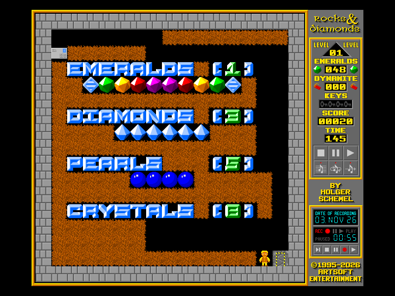
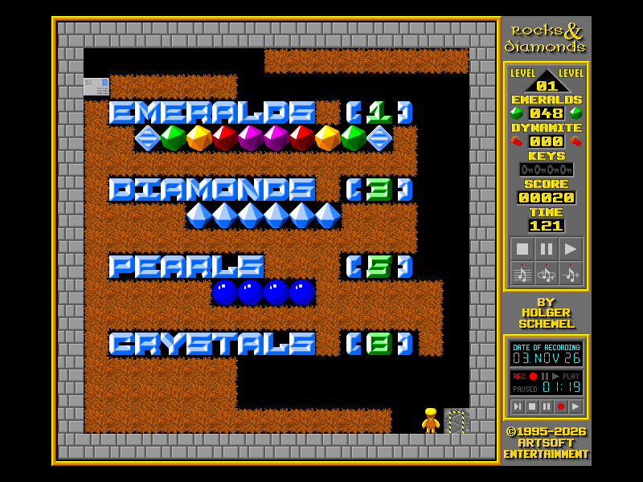

Joystick and pad: not qualified. The log has `1 joystick(s) found` and
`joystick 0 (game controller): "Amiga joystick port (2): joystick"`, so SDL
finds port 2 and the game opens it, but this lab has no stick: PortWatch
reports lowlevel.library's `ReadJoyPort(1)` as `type not available` (and
port 0, the mouse port, as `unknown`), and no stick or pad event was made.
A person with a stick or a CD32 pad in port 2 has to try it: in a level,
the stick should move the player and the red button snap.

### Sound, 3 November 2026

Commit `82dc55a` adds `patches/0005-amiga-sound.patch` (logging only);
commit `7e9092f` makes 1024 samples a buffer the AmigaOS default.
Executable (open5, Cradle job `j20261103T100001-75cb52`): SHA-256
`ea1e66628125c98e7d7067bdbf897474c924253327882f33954b4213a6ef939b`
(3,037,644 bytes; `receipts/4-sound-open5-stove_build.json`).

In `lab:rnd` (ahi.device 6.1.2, muted), `SetEnv RND_FPS 1`, with
upstream's sound settings (sound effects, loops and music on, 22,050 Hz):

- Upstream's Version Info page: platform Amiga, render driver `opengpu`,
  video driver `amigaos3`, audio driver `ahi`; SDL 2.32.10, SDL_image
  2.8.12, SDL_mixer 2.8.2. (SDL_net 2.4.0 there is the header's version,
  which `net_none.c` reports.)
- The build of `82dc55a` with upstream's 512 samples: `SDL audio "ahi":
  22050 Hz, 2 channels, format 0x9010, 512 samples a buffer` (16-bit
  big-endian stereo, 23.2 ms buffers). Over about six minutes (the
  Info screen, then two minutes of play with
  `HoldKeys 70 CYCLE 4E,4D,4E,4D,4F,4C,4F,4D,4E,4C PERIOD 25`, digging and
  collecting with their sounds): 15,361 buffers, 43.1 a second as 22,050 /
  512 gives, none late through loading and the menus; in play **112 came
  more than half a buffer late** (0.73 per cent of all, up to 9 in five
  seconds).
- The same build with `system.audio_fragment_size: 1024` (46.4 ms
  buffers) and the same play: 6,054 buffers, 21.5 a second, **4 late**
  (0.07 per cent; three in the first 40 seconds, one in play).
- So the AmigaOS default is now 1024 (`7e9092f`); a later start with no
  `setup.conf` logged `1024 samples a buffer (asked 22050 Hz, 1024
  samples)`. 46 ms is short enough for this game's effects.
- No whole-lab stop or freeze in any run in this lab, steps 2 to 5,
  every one with sound on (twelve starts of the game). The classic music
  modules are not packed (see Data and licences), and SDL2_mixer.module
  has no module player anyway, so only the effects and upstream's rhythm
  loop play; in-game music is silent.

Labs are muted: AHI was opened and fed at the full rate, which is what a
muted lab can show; that it sounds right is still to be heard on a real
instance.

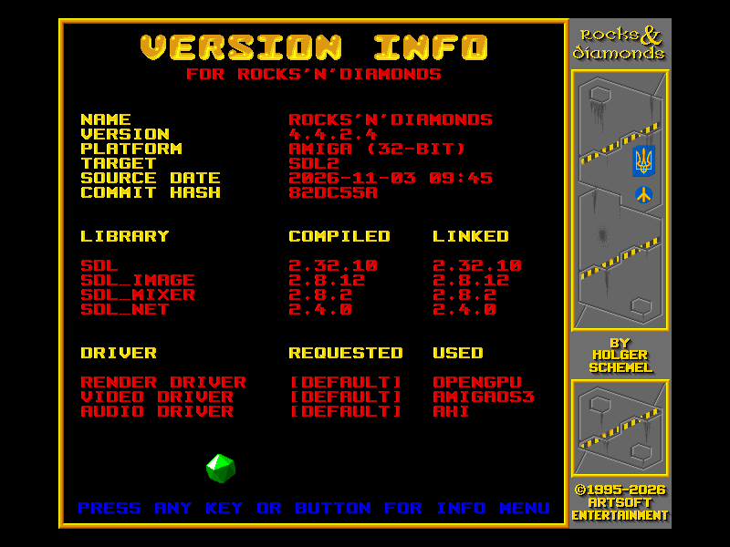
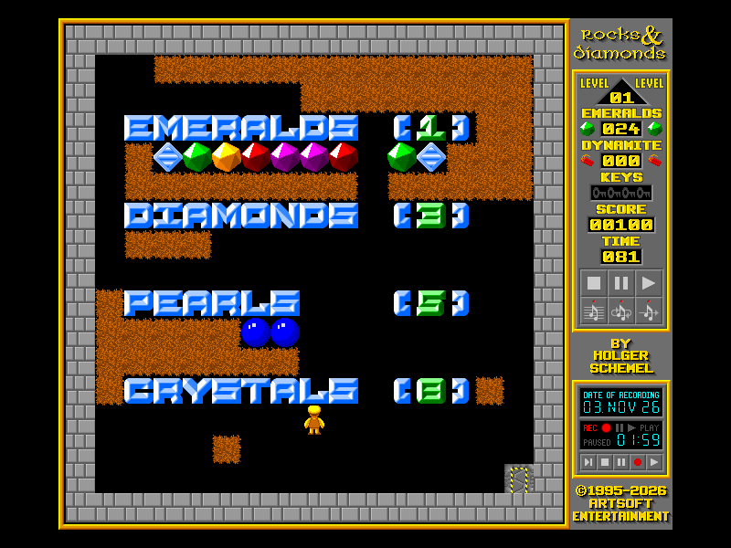

### Saves: players, settings and saved games, 3 November 2026

Rocks'n'Diamonds keeps everything a player makes in its user data
directory, here `PROGDIR:userdata`: the players (`usersetup.conf`, and a
drawer under `users/` for each), each player's settings (`setup.conf`),
progress in each level set (`levelsetup/`), scores, and tapes (recordings
of games, which upstream's F1, "save game", writes and F2 loads). No change
was needed for any of it beyond step 1's paths: the step 4 build
(`7e9092f`, `ea1e6662...939b`) was used.

In `lab:rnd`, the earlier `PROGDIR:userdata` renamed away, so the game
started with none:

- First start: `PROGDIR:userdata` made, full screen by default (no
  `setup.conf` yet), the player "anonymous".
- Name, Players & Teams: a second player, typed `amiga` in upstream's name
  entry, with the current settings copied to it. The main menu then said
  NAME: AMIGA.
- Setup, Sound & Music: "Sound effects (looping)" from on to off.
- Start Game (the first level of Niko Böhm's tutorial), 25 seconds of
  HoldKeys play, then F1: "TAPE SAVED" at 0:49 of the level's clock, score
  80. `users/001/tapes/rnd_tutorial_niko_boehm/001.tape` (238 bytes) and
  the player's `setup.conf` with `player_name: amiga` and
  `repeating_sound_loops: off` were written.
- Escape, Yes; Quit, Yes: a clean exit.
- **Cold restart:** the lab was stopped and started again. Every file under
  `PROGDIR:userdata/users/001` was still there with its size and time.
- The game started as AMIGA, with the saved tape in the tape deck (03 NOV
  26, 00:49). **F2 loaded it:** the level came back exactly as saved (the
  same tunnels, the player in the same place, score 80, the emeralds still
  needed 30, the clock at 0:49), paused, and the cursor keys played on
  from there. Setup, Sound & Music still had "Sound effects (looping):
  OFF". Quit was clean.

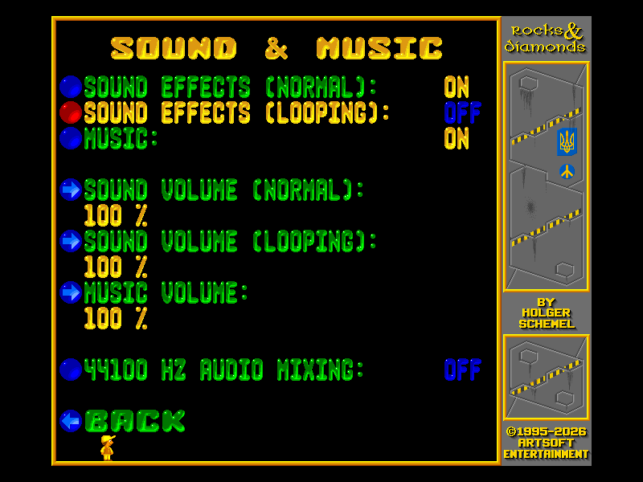
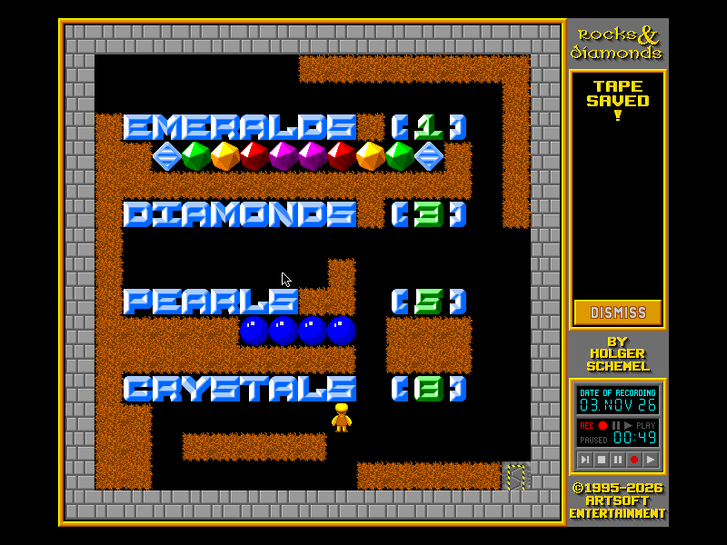
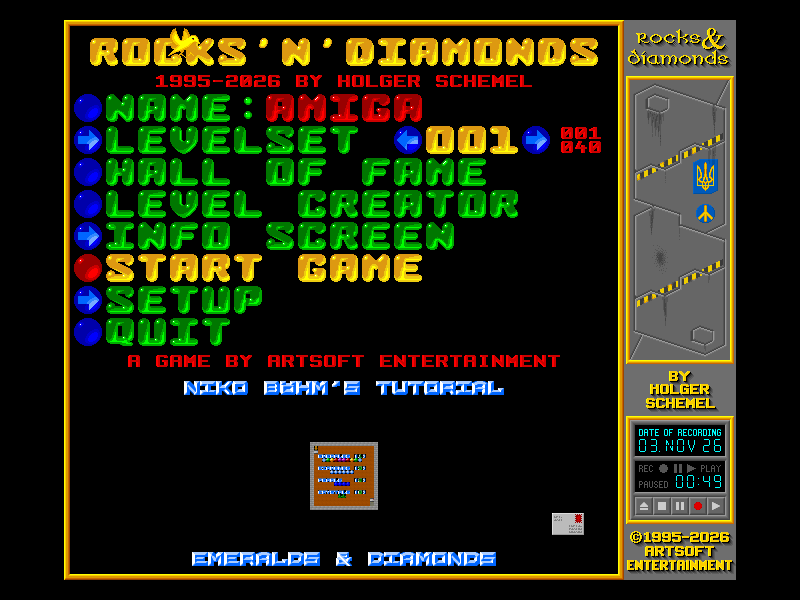
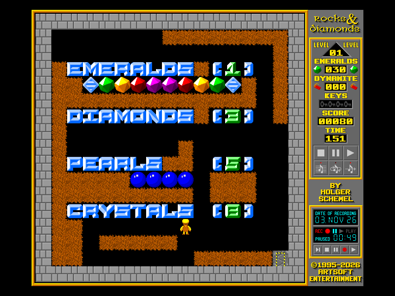
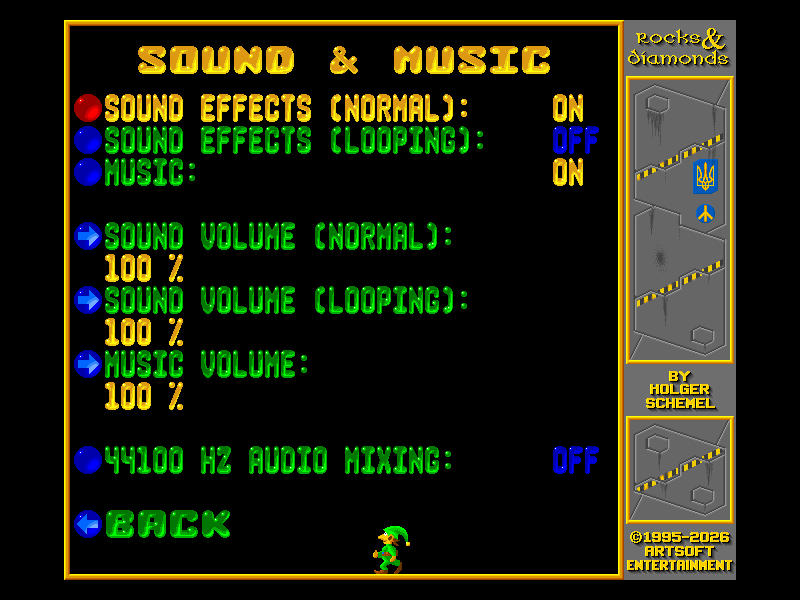

Not covered: a finished level and its high score (HoldKeys does not solve
levels), a full disk or a write-protected drawer.
